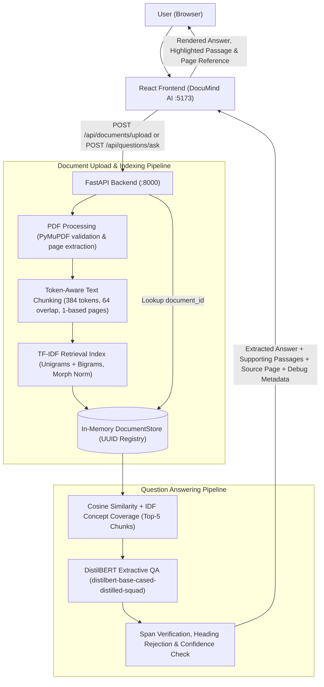

# DocuMind AI – Intelligent Document Question Answering System

-3776AB?logo=python&logoColor=white)


**DocuMind AI** is an academic Natural Language Processing (NLP) mini-project that enables users to upload selectable-text PDF documents and ask natural-language questions about their contents. It pairs **TF-IDF + cosine similarity** passage retrieval with **extractive question answering** powered by Hugging Face's pretrained `distilbert/distilbert-base-cased-distilled-squad` Transformer model, exposed through a **FastAPI** backend and a responsive **React + Tailwind CSS** dashboard.

---

## Table of Contents

- [A. Project Overview](#a-project-overview)
- [B. Key Features](#b-key-features)
- [C. Technology Stack](#c-technology-stack)
- [D. Pretrained Transformer Model](#d-pretrained-transformer-model)
- [E. System Architecture](#e-system-architecture)
- [F. Application Workflow](#f-application-workflow)
- [G. Project Folder Structure](#g-project-folder-structure)
- [H. Installation and Setup](#h-installation-and-setup)
- [I. Accessing the Application](#i-accessing-the-application)
- [J. API Documentation](#j-api-documentation)
- [K. Testing](#k-testing)
- [L. Sample Usage](#l-sample-usage)
- [M. Performance and Evaluation](#m-performance-and-evaluation)
- [N. Limitations](#n-limitations)
- [O. Future Enhancements](#o-future-enhancements)
- [P. Academic Project Information](#p-academic-project-information)
- [Q. Conclusion](#q-conclusion)

---

## A. Project Overview

Locating specific facts, definitions, or technical explanations across long multi-page PDF documents—such as lecture slide decks, textbooks, or engineering specifications—is tedious with manual reading and brittle with exact-phrase `Ctrl+F` search. At the same time, encoder-only Transformer models such as DistilBERT cannot process an entire 150-page PDF in a single forward pass because their maximum input sequence length is **512 tokens**.

**DocuMind AI** resolves this through a two-stage NLP pipeline:

1. **Lexical Document Retrieval:** Uploaded PDFs are parsed page by page with PyMuPDF, split into overlapping token-aware chunks using the DistilBERT tokenizer, and indexed per document using Scikit-learn TF-IDF vectors. When a question arrives, cosine similarity combined with IDF-weighted concept coverage retrieves the top candidate chunks while filtering out section-divider headings and question-bank noise.
2. **Extractive Question Answering:** Each retrieved chunk is passed individually with the question into `distilbert/distilbert-base-cased-distilled-squad`. The model predicts exact start and end character spans inside the PDF text, returning the strongest grounded answer, an uncalibrated model confidence score, the 1-based source PDF page number, and supporting passages.

> **Important Scope Clarification:** DocuMind AI performs **extractive question answering**—it locates and quotes verbatim spans directly from the uploaded PDF. It does **not** use a generative large language model (LLM) and does **not** perform generative Retrieval-Augmented Generation (RAG).

---

## B. Key Features

- **Drag-and-Drop PDF Upload:** Accepts `.pdf` uploads via drag-and-drop or file browser with pre-flight validation, real-time upload progress bar, file size limit (`20 MB` default), MIME type check, and `%PDF-` signature verification.
- **Page-by-Page PDF Extraction:** Extracts selectable text per page using PyMuPDF (`pymupdf`), cleans hyphenated line breaks and irregular whitespace, preserves accurate 1-based PDF page numbers, skips blank pages with reporting, and rejects encrypted, empty, corrupted, or image-only/scanned PDFs cleanly.
- **Token-Aware Text Chunking:** Uses the DistilBERT fast tokenizer (`return_offsets_mapping=True`) to divide long pages into overlapping `384`-token chunks (`64`-token overlap) snapped to word boundaries, ensuring `question + chunk + special tokens <= 512` without crossing page boundaries.
- **Enhanced TF-IDF Retrieval:** Uses unigrams and bigrams (`ngram_range=(1, 2)`), sublinear term frequency scaling (`1 + log(tf)`), custom academic stop-word filtering, lightweight morphological normalization (`layers` ↔ `layer`, `networks` ↔ `network`), exam-rubric stripping (`(06 Marks)`), and near-duplicate chunk diversity.
- **Cosine Similarity + Concept Coverage:** Ranks document chunks using cosine similarity combined with IDF-weighted query concept coverage while down-weighting bare section-divider slides and exam question-bank pages (`TOP_K_CHUNKS=5`).
- **DistilBERT Extractive QA:** Loads `distilbert/distilbert-base-cased-distilled-squad` once at FastAPI startup with automatic CUDA GPU / CPU detection, evaluates top-3 spans per retrieved chunk (`max_answer_len=50`), avoids returning bare headings or question echoes, and verifies character offsets (`chunk.text[start:end] == answer`).
- **Multiple Questions per Document:** Stores processed pages, chunks, and TF-IDF matrices in a thread-safe in-memory UUID registry (`DocumentStore`) so users can ask unlimited follow-up questions without re-uploading the PDF.
- **Confidence Scores & Guardrails:** Displays the DistilBERT span confidence score alongside an explicit UI/documentation disclaimer that it is not a calibrated probability of correctness, withholding answers below `CONFIDENCE_THRESHOLD=0.1` (`low_confidence`) or when no vocabulary overlap exists (`no_relevant_content`).
- **Supporting Passages, Page Citations & Debug Details:** Highlights the extracted answer span (`answer_start` to `answer_end`) inside the primary supporting passage, shows additional relevant supporting passages across other retrieved pages (`supporting_passages`), preserves 1-based PDF page references, and provides a collapsible **Retrieval & QA Debug Details** drawer (`retrieved_chunks`).
- **Document Management:** Displays filename, UUID, total pages, pages with text, skipped empty pages, chunk count, character count, file size, and upload timestamp, with metadata refresh (`GET /api/documents/{id}`) and confirmed deletion (`DELETE /api/documents/{id}`).
- **Responsive React Dashboard & Health Monitoring:** Clean three-column light-theme SaaS workspace (`QA Workspace`, `Document Details`, `Model & System`) that polls `GET /api/health` every 30 seconds to monitor backend availability, loaded model status, and CUDA/CPU compute device.

---

## C. Technology Stack

### Frontend (`frontend/package.json`)

| Technology | Version / Spec | Role |
| :--- | :--- | :--- |
| **React** | `^18.3.1` (`react`, `react-dom`) | Component-based UI and custom hooks |
| **Vite** | `^5.4.10` (`@vitejs/plugin-react ^4.3.3`) | Fast development server (`127.0.0.1:5173`) and production bundler |
| **JavaScript** | ES Modules (`"type": "module"`) | Application logic, state hooks, and API integration |
| **Tailwind CSS** | `^3.4.14` (`postcss`, `autoprefixer`) | Responsive light-theme SaaS layout and utility styling |
| **Axios** | `^1.7.7` | HTTP client, multipart upload progress tracking, and error normalization |
| **Lucide React** | `^0.454.0` | UI icons across navigation, upload, chat, source panel, and diagnostics |

### Backend (`backend/requirements.txt`)

| Technology | Version / Spec | Role |
| :--- | :--- | :--- |
| **Python** | `3.11+` *(verified on `3.12.3`)* | Backend runtime |
| **FastAPI** | `>=0.110` | REST API routing, OpenAPI/Swagger (`/docs`), CORS, exception handling |
| **Uvicorn** | `uvicorn[standard]>=0.29` | ASGI web server (`127.0.0.1:8000`) |
| **Pydantic & Settings** | `pydantic>=2.6`, `pydantic-settings>=2.2` | Request/response schema validation and `.env` configuration |
| **PyTorch** | `>=2.2` | Deep learning runtime with automatic CUDA GPU / CPU detection |
| **Hugging Face Transformers** | `>=4.40,<5` | `AutoTokenizer`, `AutoModelForQuestionAnswering`, and `"question-answering"` pipeline |
| **PyMuPDF** | `>=1.24.3` (imported as `pymupdf`) | Fast page-by-page PDF parsing and text extraction |
| **Scikit-learn & NumPy** | `scikit-learn>=1.4`, `numpy>=1.26` | `TfidfVectorizer` and `cosine_similarity` retrieval |
| **Pytest & HTTPX** | `pytest>=8.0`, `httpx>=0.27` | Automated unit, mocked API, and real-model integration tests |

> **Dependency Note:** `transformers` is pinned to `>=4.40,<5` because `transformers 5.x` removed the `"question-answering"` pipeline task required by this backend.

---

## D. Pretrained Transformer Model

- **Exact Model ID:** `distilbert/distilbert-base-cased-distilled-squad`
- **No Fine-Tuning or Secondary Models:** The pretrained weights are loaded once at application startup via `AutoTokenizer`, `AutoModelForQuestionAnswering`, and `transformers.pipeline("question-answering")` without training, fine-tuning, or introducing any secondary Transformer or neural embedding model.

### What DistilBERT Is and Why It Is Used

DistilBERT is a distilled, 6-layer Transformer encoder derived from 12-layer BERT-base using knowledge distillation. It has roughly **40% fewer parameters** and runs **~60% faster** while preserving approximately **97%** of BERT's language-understanding capability. This makes it practical for fast local academic deployments on both laptop GPUs (such as an NVIDIA RTX 3050) and CPUs. The `cased` checkpoint retains uppercase/lowercase distinctions, which helps identify proper nouns, acronyms, and model/author names.

### How Extractive Span Prediction Works

`distilbert-base-cased-distilled-squad` was fine-tuned by Hugging Face on **SQuAD v1.1** (Stanford Question Answering Dataset). Given a question and a retrieved PDF chunk formatted as:

```text
[CLS] <question tokens> [SEP] <context chunk tokens> [SEP]
```

the model's span-classification head outputs two probability distributions across the context tokens—one predicting the **start token** and one predicting the **end token** of the answer. The Hugging Face pipeline maps the top-scoring `(start_token, end_token)` pair back to exact character offsets `(start, end)` inside the chunk text. Because SQuAD models expect interrogative phrasing, `QAService` also normalizes exam-rubric prompts (e.g., stripping `(06 Marks)` and rewriting `"Explain why ..."` to `"Why ...?"`) before calling the pipeline.

### Interpreting Confidence Scores

The `confidence` field returned by the API is derived from the model's start/end softmax span score for that specific `(question, chunk)` pair. **It is an uncalibrated model confidence score, not a calibrated probability of factual correctness.** Because SQuAD v1.1 contains only answerable questions, DistilBERT always scores some candidate span inside whatever passage it receives. DocuMind AI mitigates false positives using TF-IDF relevance filtering (`question_vector.nnz == 0`), heading/question-echo penalties, and `CONFIDENCE_THRESHOLD=0.1`, but high model scores on partially overlapping off-topic chunks remain possible.

### Extractive QA vs. Retrieval vs. Generative RAG

| Dimension | Document Retrieval (`TfidfRetriever`) | Extractive QA (`DistilBERT`) | Generative RAG *(Not Used)* |
| :--- | :--- | :--- | :--- |
| **Purpose** | Finds which PDF chunks match the question | Extracts the exact start–end substring inside a chunk | Synthesizes new free-form prose using an LLM |
| **Mechanism** | Sparse TF-IDF vectors + cosine similarity | Encoder Transformer predicting span start/end logits | Dense embeddings + autoregressive decoder LLM |
| **Output** | Ranked chunks + original 1-based page numbers | Verbatim substring copied directly from the PDF | Newly generated text (prone to hallucination) |

---

## E. System Architecture



---

## F. Application Workflow

1. **User Uploads a PDF:** Via drag-and-drop or the file browser in the React dashboard, the client sends a `multipart/form-data` request to `POST /api/documents/upload` with live upload progress tracking.
2. **Backend Validates the PDF:** Middleware and `pdf_service.validate_pdf_upload` enforce `.pdf` extension, allowed MIME type, non-empty payload, `<= 20 MB` file size, and `%PDF-` header signature within the first 1024 bytes.
3. **PyMuPDF Extracts Text Page by Page:** `extract_text_from_pdf` opens the PDF bytes with `pymupdf.open`, rejects encrypted or 0-page files, extracts text page by page while preserving 1-based page numbers, rejoins hyphenated line breaks, tracks blank pages, and rejects scanned image-only PDFs with `422 no_extractable_text` (explaining OCR is unsupported).
4. **Text Is Divided into Token-Aware Chunks:** `text_chunking.chunk_pages` uses the DistilBERT fast tokenizer to split each page independently into overlapping `384`-token chunks (`64`-token overlap) snapped to word boundaries so chunks never exceed the 512-token limit or cross page boundaries.
5. **TF-IDF Vectors Are Generated:** `TfidfRetriever` builds a per-document TF-IDF matrix using stem-normalized text, unigrams/bigrams, sublinear TF scaling, and precomputed flags for heading-only slides and exam question banks, registering everything under a UUID in `DocumentStore`.
6. **User Asks a Question:** From the chat panel, the user submits a question (up to 500 characters / 64 DistilBERT tokens) to `POST /api/questions/ask` using the active `document_id`.
7. **Cosine Similarity Retrieves Relevant Chunks:** `TfidfRetriever.retrieve` cleans rubric tags (`(06 Marks)`), computes cosine similarity and IDF-weighted concept coverage across all chunks, down-weights bare headings and question-bank pages, enforces near-duplicate diversity, and returns up to `5` top chunks. If no terms overlap, it returns `no_relevant_content`.
8. **DistilBERT Extracts the Best Answer Span:** `QAService` rewrites imperative prompts into SQuAD-style questions, invokes `ModelService.predict_candidates(..., top_k=3, max_answer_len=50)` on each retrieved chunk individually, verifies offsets (`chunk.text[start:end]`), penalizes title echoes or rhetorical questions, selects the strongest candidate, and checks `CONFIDENCE_THRESHOLD` (`0.1`).
9. **Frontend Displays Answer & Source Reference:** The React UI displays the extracted answer (and clearly distinguishes descriptive key spans from prose essays), model confidence score with uncalibrated caveat, primary and additional supporting passages across PDF pages, exact highlighted answer span in `SourcePanel`, and optional retrieval debug metrics.

---

## G. Project Folder Structure

```text
Intelligent Document Question Answering System/
├── README.md                                 # Complete root project documentation
├── backend/
│   ├── app/
│   │   ├── __init__.py
│   │   ├── config.py                         # Pydantic Settings (.env loading & token-budget checks)
│   │   ├── exceptions.py                     # Domain exceptions mapped to clean HTTP errors
│   │   ├── main.py                           # FastAPI factory, lifespan model load, CORS, middleware
│   │   ├── api/
│   │   │   ├── __init__.py
│   │   │   └── routes.py                     # REST endpoints under /api
│   │   ├── schemas/
│   │   │   ├── __init__.py
│   │   │   └── request_response.py           # AskRequest, AskResponse, SourceInfo, RetrievedChunkDebug, etc.
│   │   ├── services/
│   │   │   ├── __init__.py
│   │   │   ├── document_service.py           # Upload orchestration: validate -> extract -> chunk -> index -> store
│   │   │   ├── model_service.py              # Single startup load of DistilBERT QA, CUDA/CPU detection
│   │   │   ├── pdf_service.py                # PDF validation & PyMuPDF page-by-page extraction
│   │   │   ├── qa_service.py                 # Query normalization, span refinement, scoring & debug data
│   │   │   └── retrieval_service.py          # TF-IDF + cosine similarity + concept coverage & diversity
│   │   ├── storage/
│   │   │   ├── __init__.py
│   │   │   └── document_store.py             # Thread-safe in-memory UUID document registry
│   │   └── utils/
│   │       ├── __init__.py
│   │       └── text_chunking.py              # DistilBERT token-aware overlapping page chunker
│   ├── samples/
│   │   └── sample_nlp_document.pdf           # 4-page sample NLP PDF for testing & demos
│   ├── scripts/
│   │   └── create_sample_pdf.py              # Script to regenerate samples/sample_nlp_document.pdf
│   ├── tests/
│   │   ├── __init__.py
│   │   ├── conftest.py                       # FakeModelService, SimpleTokenizer & PDF test helpers
│   │   ├── test_api.py                       # FastAPI endpoint, CORS, validation & error handling tests
│   │   ├── test_integration_real_model.py    # Optional end-to-end tests using real DistilBERT weights
│   │   ├── test_pdf_service.py               # PDF validation, OCR/encryption/corruption & extraction tests
│   │   ├── test_qa_service.py                # Span refinement, ranking, threshold & debug tests
│   │   ├── test_retrieval_service.py         # TF-IDF, plural matching & rubric/heading tests
│   │   └── test_text_chunking.py             # Token-aware chunking & word-boundary overlap tests
│   ├── uploads/
│   │   └── .gitkeep                          # Runtime storage directory for <document_id>.pdf files
│   ├── .env.example                          # Backend environment configuration template
│   ├── .gitignore
│   ├── pytest.ini
│   ├── README.md                             # Detailed backend module & API documentation
│   ├── requirements.txt                      # Python dependencies
│   └── run.py                                # Uvicorn ASGI server entrypoint
└── frontend/
    ├── public/
    │   └── favicon.svg
    ├── src/
    │   ├── assets/
    │   │   └── logo.svg
    │   ├── components/
    │   │   ├── ChatInterface.jsx             # Multi-turn Q&A chat UI & supporting passages view
    │   │   ├── DocumentCard.jsx              # Active document metadata, refresh & confirmed delete
    │   │   ├── DocumentUpload.jsx            # Drag-and-drop PDF upload with progress & validation
    │   │   ├── Header.jsx                    # Top bar with model, device & live API status
    │   │   ├── Sidebar.jsx                   # Workspace / Document Details / Model & System navigation
    │   │   ├── SourcePanel.jsx               # Highlighted span citation, extra passages & debug drawer
    │   │   ├── StatsOverview.jsx             # 4 dashboard KPI summary cards
    │   │   └── SystemStatusView.jsx          # /api/health diagnostics & 3-stage pipeline summary
    │   ├── hooks/
    │   │   ├── useBackendHealth.js           # Polls /api/health every 30s
    │   │   └── useDocumentQA.js              # Manages upload, details, deletion & Q&A state
    │   ├── pages/
    │   │   └── Dashboard.jsx                 # Responsive 3-column application shell
    │   ├── services/
    │   │   └── api.js                        # Axios API client & normalized error handler
    │   ├── utils/
    │   │   └── formatters.js                 # Byte, date/time & score formatting helpers
    │   ├── App.jsx
    │   ├── index.css                         # Tailwind base styles & custom scrollbars
    │   └── main.jsx
    ├── .env                                  # Frontend environment variables (VITE_API_BASE_URL)
    ├── .env.example                          # Frontend environment template
    ├── .gitignore
    ├── index.html
    ├── package.json
    ├── package-lock.json
    ├── postcss.config.js
    ├── README.md                             # Frontend setup & component guide
    ├── tailwind.config.js
    └── vite.config.js
```

---

## H. Installation and Setup

### Prerequisites (Linux)

- **Python 3.11 or 3.12** (tested on Python `3.12.3`) with `pip` and `venv`
- **Node.js 18+ / 20+** (tested on Node `v20.20.2`) and **npm** (tested on `10.8.2`)
- **Git** (optional, for cloning)
- **Internet connection** on first startup to download `distilbert/distilbert-base-cased-distilled-squad` (~260 MB) from the Hugging Face Hub (automatically cached in `~/.cache/huggingface/hub` afterwards)
- **Optional:** NVIDIA GPU with CUDA drivers (detected automatically; falls back to CPU if unavailable)

### 1. Backend Setup

Open **Terminal 1** from the project root directory:

```bash
cd backend

# Create and activate a Python virtual environment
python3 -m venv .venv
source .venv/bin/activate

# Upgrade pip and install backend dependencies
pip install --upgrade pip
pip install -r requirements.txt

# Optional: create .env to override default settings
cp .env.example .env

# Start the FastAPI backend
python run.py
```

Once the model is cached after the first run, you can start the backend completely offline with:

```bash
HF_HUB_OFFLINE=1 python run.py
```

#### Key Backend Environment Variables (`backend/.env.example`)

| Variable | Default | Purpose |
| :--- | :--- | :--- |
| `HOST` / `PORT` | `127.0.0.1` / `8000` | Uvicorn bind host and port |
| `MODEL_NAME` | `distilbert/distilbert-base-cased-distilled-squad` | Mandatory pretrained DistilBERT QA model |
| `DEVICE` | `auto` | `auto` (CUDA if available else CPU), `cuda`, or `cpu` |
| `MAX_UPLOAD_SIZE_MB` | `20` | Maximum allowed PDF upload size |
| `CHUNK_SIZE_TOKENS` / `CHUNK_OVERLAP_TOKENS` | `384` / `64` | DistilBERT token window and overlap per page chunk |
| `MAX_QUESTION_TOKENS` | `64` | Maximum allowed question tokens (`384 + 64 + 3 = 451 <= 512`) |
| `TOP_K_CHUNKS` | `5` | Number of top retrieved chunks evaluated by DistilBERT |
| `CONFIDENCE_THRESHOLD` | `0.1` | Minimum model span score required to accept an answer |
| `MAX_ANSWER_LENGTH_TOKENS` | `50` | Maximum extracted answer length in tokens |
| `CORS_ORIGINS` | `http://localhost:3000,http://localhost:5173,http://127.0.0.1:5173` | Allowed frontend origins |

### 2. Frontend Setup

Open **Terminal 2** from the project root directory:

```bash
cd frontend

# Install npm packages
npm install

# Verify or create .env pointing to the FastAPI backend
cp .env.example .env
# Default content: VITE_API_BASE_URL=http://127.0.0.1:8000

# Start the Vite development server
npm run dev
```

### Running Both Servers Simultaneously

- Keep **Terminal 1** running `python run.py` inside `backend/` (with `.venv` activated) on `http://127.0.0.1:8000`.
- Keep **Terminal 2** running `npm run dev` inside `frontend/` on `http://127.0.0.1:5173`.
- Verify the header badge in the web interface changes to **Model Ready** (`Online · CUDA` or `Online · CPU`).

---

## I. Accessing the Application

| Service / Resource | URL | Notes |
| :--- | :--- | :--- |
| **DocuMind AI Frontend** | `http://127.0.0.1:5173` | Vite development server (also accepts `http://localhost:5173`) |
| **FastAPI Backend Base URL** | `http://127.0.0.1:8000` | Root endpoint `/` returns API links |
| **Swagger Interactive Docs** | `http://127.0.0.1:8000/docs` | Interactive OpenAPI UI to test all 5 API routes |
| **ReDoc Documentation** | `http://127.0.0.1:8000/redoc` | Alternative OpenAPI reference view |
| **Health Check Endpoint** | `http://127.0.0.1:8000/api/health` | JSON backend & DistilBERT status |

---

## J. API Documentation

All error responses share a uniform JSON format without exposing stack traces or server paths:

```json
{
  "success": false,
  "error": "error_code",
  "message": "Human-readable explanation",
  "details": ["optional validation details"]
}
```

### 1. Health Check — `GET /api/health`

- **Method & Path:** `GET /api/health`
- **Purpose:** Reports backend status (`ok` or `degraded`), model loading state, model name, active compute device (`cuda`/`cpu`), GPU name, any startup load error, and count of documents in memory.
- **Request Format:** No request body or query parameters.

**Example Response (`200 OK`):**
```json
{
  "status": "ok",
  "model_loaded": true,
  "model_status": "loaded",
  "model_name": "distilbert/distilbert-base-cased-distilled-squad",
  "device": "cuda",
  "device_name": "NVIDIA GeForce RTX 3050 4GB Laptop GPU",
  "model_error": null,
  "documents_in_memory": 0
}
```

- **Important States:** If startup model loading fails, returns `status: "degraded"`, `model_loaded: false`, `model_status: "failed"`, and a sanitized `model_error` message.

---

### 2. Upload PDF — `POST /api/documents/upload`

- **Method & Path:** `POST /api/documents/upload`
- **Purpose:** Validates an uploaded PDF, extracts text page by page with PyMuPDF, builds token-aware chunks, fits the per-document TF-IDF retriever, saves `uploads/<document_id>.pdf`, and registers the document in memory.
- **Request Format:** `multipart/form-data` with field `file` (`.pdf`, max 20 MB by default).

```bash
curl -s -X POST http://127.0.0.1:8000/api/documents/upload \
  -F "file=@backend/samples/sample_nlp_document.pdf"
```

**Example Response (`201 Created`):**
```json
{
  "success": true,
  "document_id": "0e67f4ef-9a9b-4b4a-9b86-5a5290689655",
  "filename": "sample_nlp_document.pdf",
  "num_pages": 4,
  "num_chunks": 4,
  "pages_with_text": 4,
  "empty_pages": [],
  "status": "ready",
  "message": "PDF processed successfully: 4 page(s), 4 chunk(s)."
}
```

- **Error Responses:** `400 empty_file` (0 bytes), `413 file_too_large` (> 20 MB), `415 invalid_file_type` (wrong extension, MIME type, or missing `%PDF-`), `422 corrupted_pdf` / `encrypted_pdf` / `empty_pdf` / `no_extractable_text` (scanned PDFs without selectable text, noting OCR is not supported), `503 model_not_ready`.

---

### 3. Ask a Question — `POST /api/questions/ask`

- **Method & Path:** `POST /api/questions/ask`
- **Purpose:** Retrieves top relevant chunks for the given `document_id`, runs DistilBERT QA on each retrieved chunk, ranks candidate spans, and returns the extracted answer, confidence, source page/passage, additional supporting passages, and retrieval debug info.
- **Request Format (`application/json`):**

```json
{
  "document_id": "0e67f4ef-9a9b-4b4a-9b86-5a5290689655",
  "question": "Who created DistilBERT?"
}
```

**Example Response — Answer Found (`200 OK`):**
```json
{
  "success": true,
  "status": "answered",
  "document_id": "0e67f4ef-9a9b-4b4a-9b86-5a5290689655",
  "question": "Who created DistilBERT?",
  "question_type": "factual",
  "answer": "Hugging Face",
  "confidence": 0.9695,
  "source": {
    "page_number": 4,
    "passage": "DistilBERT and Question Answering DistilBERT is a smaller version of BERT created by Hugging Face using knowledge distillation. It has 40 percent fewer parameters than BERT and runs 60 percent faster, while retaining about 97 percent of BERT's language understanding performance. The model distilbert-base-cased-distilled-squad was fine-tuned on the Stanford Question Answering Dataset (SQuAD),",
    "answer_start": 85,
    "answer_end": 97,
    "chunk_id": 3,
    "retrieval_score": 0.2005,
    "answer_span": "Hugging Face",
    "confidence": 0.9695
  },
  "supporting_passages": [
    {
      "page_number": 4,
      "passage": "DistilBERT and Question Answering DistilBERT is a smaller version of BERT created by Hugging Face...",
      "answer_start": 85,
      "answer_end": 97,
      "chunk_id": 3,
      "retrieval_score": 0.2005,
      "answer_span": "Hugging Face",
      "confidence": 0.9695
    }
  ],
  "retrieved_chunks": [
    {
      "rank": 1,
      "chunk_id": 3,
      "page_number": 4,
      "retrieval_score": 0.2005,
      "raw_tfidf_score": 0.2005,
      "concept_coverage": 1.0,
      "matched_concepts": ["created", "distilbert"],
      "num_tokens": 92,
      "is_heading_only": false,
      "candidate_answer": "Hugging Face",
      "candidate_score": 0.9695,
      "text_preview": "DistilBERT and Question Answering..."
    }
  ],
  "message": "Answer retrieved successfully"
}
```

**Example Response — Unanswerable / Off-Topic (`200 OK`, `success: false`):**
```json
{
  "success": false,
  "status": "no_relevant_content",
  "document_id": "0e67f4ef-9a9b-4b4a-9b86-5a5290689655",
  "question": "Who won the football world cup?",
  "question_type": "factual",
  "answer": null,
  "confidence": null,
  "source": null,
  "supporting_passages": [],
  "retrieved_chunks": [],
  "message": "No relevant passages were found in the document for this question. The document may not contain this information. Try rephrasing the question using keywords that appear in the document."
}
```

- **Possible HTTP 200 `status` Values:** `answered`, `low_confidence` (`answer: null`, closest `source` included for reference), `no_relevant_content`, `no_answer`.
- **Error Responses:** `400 invalid_question` (exceeds 64 tokens), `404 document_not_found`, `422 validation_error` (empty/missing question, > 500 chars, or invalid JSON), `500 model_inference_error`, `503 model_not_ready`.

---

### 4. Get Document Details — `GET /api/documents/{document_id}`

- **Method & Path:** `GET /api/documents/{document_id}`
- **Purpose:** Returns stored metadata, page/chunk counts, character count, file size, status, and upload timestamp for an active document.
- **Request Format:** Path parameter `document_id` (UUID string).

**Example Response (`200 OK`):**
```json
{
  "success": true,
  "document_id": "0e67f4ef-9a9b-4b4a-9b86-5a5290689655",
  "filename": "sample_nlp_document.pdf",
  "num_pages": 4,
  "num_chunks": 4,
  "pages_with_text": 4,
  "empty_pages": [],
  "total_characters": 1713,
  "file_size_bytes": 4081,
  "status": "ready",
  "uploaded_at": "2026-11-19T14:20:15.476558Z"
}
```

- **Error Responses:** `404 document_not_found`.

---

### 5. Delete Document — `DELETE /api/documents/{document_id}`

- **Method & Path:** `DELETE /api/documents/{document_id}`
- **Purpose:** Removes the document entry from the in-memory `DocumentStore` and deletes its temporary PDF from `backend/uploads/`.
- **Request Format:** Path parameter `document_id` (UUID string).

**Example Response (`200 OK`):**
```json
{
  "success": true,
  "document_id": "0e67f4ef-9a9b-4b4a-9b86-5a5290689655",
  "message": "Document 'sample_nlp_document.pdf' was deleted."
}
```

- **Error Responses:** `404 document_not_found`.

---

## K. Testing

### 1. Backend Unit and API Tests (Mocked Inference)

Uses `FakeModelService` and `SimpleTokenizer` in `backend/tests/conftest.py` so tests run offline without downloading weights:

```bash
cd backend
.venv/bin/python -m compileall -q app tests run.py scripts
.venv/bin/python -m pytest -v
```

- **Verified Result:** `89 passed, 7 skipped in 4.53s` (integration tests are skipped unless `RUN_INTEGRATION_TESTS=1`). Covers PDF validation, PyMuPDF extraction, 0-page/corrupted/encrypted/scanned PDF errors, token-aware chunking, TF-IDF retrieval, plural normalization, rubric/heading filtering, span refinement, QA scoring, all API endpoints, CORS, and sanitized 500 error handling.

### 2. Backend Real-Model Integration Tests

Runs end-to-end tests through FastAPI using the actual `distilbert/distilbert-base-cased-distilled-squad` model:

```bash
cd backend
RUN_INTEGRATION_TESTS=1 .venv/bin/python -m pytest -m integration -v
# Or offline after first download:
HF_HUB_OFFLINE=1 RUN_INTEGRATION_TESTS=1 .venv/bin/python -m pytest -m integration -v
```

- **Verified Result:** `7 passed, 89 deselected in 3.95s`.

### 3. Frontend Production Build

```bash
cd frontend
npm run build
```

- **Verified Result:** `1643 modules transformed`, built production bundle (`dist/index.html`, CSS, and JS) in `1.50s` with 0 errors.

### 4. Manual PDF & Question Testing

You can test manually either through the React UI (`http://127.0.0.1:5173`), Swagger UI (`http://127.0.0.1:8000/docs`), or `curl` using the included 4-page sample PDF (`backend/samples/sample_nlp_document.pdf`):

```bash
# 1. Check health
curl -s http://127.0.0.1:8000/api/health

# 2. Upload sample PDF and copy the returned document_id
curl -s -X POST http://127.0.0.1:8000/api/documents/upload \
  -F "file=@backend/samples/sample_nlp_document.pdf"

# 3. Ask a question (replace <DOCUMENT_ID>)
curl -s -X POST http://127.0.0.1:8000/api/questions/ask \
  -H "Content-Type: application/json" \
  -d '{"document_id": "<DOCUMENT_ID>", "question": "When was the Transformer architecture introduced?"}'
```

---

## L. Sample Usage

1. **Start the Application:** Run `python run.py` in `backend/` and `npm run dev` in `frontend/`, then open `http://127.0.0.1:5173`. Confirm the header badge reads **Model Ready**.
2. **Upload an NLP PDF:** Drag and drop a lecture or reference PDF (for example, `backend/samples/sample_nlp_document.pdf`) onto the upload card or click **Browse Files**. Wait for the progress bar to finish and inspect the **Document Information** card (filename, pages, chunks, file size).
3. **Ask a Factual Question:** Type `"Who created DistilBERT?"` in the question bar and click **Ask**.
4. **View the Extracted Answer:** The chat card displays `"Hugging Face"` as the verbatim extracted answer span.
5. **Check Confidence Score:** Inspect the **Model Score** badge (`0.9695` / `97.0%`) along with the reminder that it is an uncalibrated span score rather than a probability of correctness.
6. **Inspect Supporting Passage & Source Page:** Look at the **Source Reference** panel on the right to see **Page 4**, **Chunk #3**, **TF-IDF Cosine Sim**, and the supporting passage with `Hugging Face` highlighted in yellow. Expand **Retrieval & QA Debug Details** to review all ranked chunks and matched concepts.
7. **Ask Follow-Up Questions:** Ask `"When was the Transformer architecture introduced?"` (returns `"2017"` from Page 3) or descriptive questions without re-uploading the PDF. Switch between cited questions using the `Q1 · p.4` / `Q2 · p.3` buttons in the Source Reference panel.
8. **Delete the Document:** Click **Delete PDF** → **Confirm** in the Document Card (or in the **Document Details** sidebar tab) to remove the document from backend memory and delete its uploaded PDF file from `backend/uploads/`.

---

## M. Performance and Evaluation

To evaluate real-world academic performance beyond short synthetic examples, the updated pipeline was tested through FastAPI (`/api/documents/upload` + `/api/questions/ask`) against an actual **156-page NLP lecture & question-bank PDF** (`156` pages, `162` token-aware chunks, `4,754` TF-IDF vocabulary terms) using **15 diverse questions** (factual, descriptive, and out-of-domain).

### Methodology

- Each PDF page was extracted with PyMuPDF (`0` empty pages), chunked using the DistilBERT fast tokenizer (`384` tokens, `64` overlap), and indexed once.
- Both factual queries (e.g., `"Who..."`, `"What..."`, `"Why..."`) and multi-concept exam-style descriptive questions (including `"(06 Marks)"` prompts) were evaluated, plus an unanswerable out-of-domain question (`Q15`).
- Every returned `answer`, `confidence`, `source.page_number`, `supporting_passages`, and `retrieved_chunks` debug trace was checked directly against the corresponding PDF pages, verifying `passage[answer_start:answer_end] == answer`.

### Evaluation Results (`15` Questions on 156-Page NLP PDF)

| ID | Question | Type | Page | Model Score | TF-IDF Sim | Extracted Answer & Assessment |
| :--- | :--- | :--- | :---: | :---: | :---: | :--- |
| **Q01** | `Explain the architecture of a feedforward neural network, identifying input, hidden and output layers. (06 Marks)` | Descriptive | `85` | `0.6487` | `0.1018` | **Partially Complete (Extractive):** `'multi-layer perceptrons (or MLPs) for historical reasons'`. Correctly bypassed Page 84 bare heading and Page 155 question bank; supporting passages `[P85, P91, P130, P86]` surfaced `P91`'s `'hidden units (σ node) Input layer (vector) Output layer (σ node) Could be ReLU Or tanh'`, `P130`, and `P86`. Cannot generate a full 6-mark prose essay due to extractive architecture. |
| **Q02** | `What can Feedforward Neural Networks also be called for historical reasons?` | Factual | `85` | `0.8240` | `0.5807` | **Correct:** `'multi-layer perceptrons'` |
| **Q03** | `What are the three affective dimensions of connotation proposed by Osgood et al.?` | Factual | `26` | `0.1374` | `0.2845` | **Correct:** `'valence: pleasantness ◦arousal: intensity of emotion ◦dominance: the degree of control exerted ◦'` |
| **Q04** | `Who stated that the meaning of a word is its use in the language?` | Factual | `21` | `0.9840` | `0.7048` | **Correct:** `'Ludwig Wittgenstein'` |
| **Q05** | `What does the English borrowing ongchoi mean?` | Factual | `24` | `0.8593` | `0.0412` | **Correct:** `'Water Spinach'` (avoided rhetorical question on Page 23) |
| **Q06** | `Why is raw dot-product problematic for computing word similarity?` | Descriptive | `47` | `0.2828` | `0.3266` | **Partially Correct (Secondary Page):** `P47` extracted `'The dot product tends to be high when the two vectors have large values in the same dimensions...'`; **Supporting Passage #1 (`P48`, sim `0.3292`)** explicitly gave `'favors long vectors Dot product is higher if a vector is longer... Vector length: Frequent words (of, the, you) have long vectors'`. |
| **Q07** | `What are the two sets of embeddings learned by Skip-gram with Negative Sampling (SGNS)?` | Factual | `81` | `0.3117` | `0.2618` | **Correct:** `'Target embeddings matrix W Context embedding matrix C'` |
| **Q08** | `What activation functions can be used in the hidden units of a two-layer network?` | Factual | `91` | `0.2287` | `0.2482` | **Failed Primary Span:** Extracted `'scalar'` from `P91` (`"Two-Layer Network with scalar output ... Could be ReLU Or tanh"`) instead of `'ReLU Or tanh'`. `P148` (`'Sigmoid'`, score `0.5630`) appeared in supporting passages `[91, 148, 134, 149]`. |
| **Q09** | `What is the shape of an embedding matrix E for a vocabulary V and dimension d?` | Factual | `113` | `0.2200` | `0.4523` | **Correct:** `'[|V| × d]'` |
| **Q10** | `What loss function is used for binary logistic regression?` | Factual | `131` | `0.4851` | `0.3581` | **Correct:** `'Cross entropy'` |
| **Q11** | `Who introduced error backpropagation in 1986?` | Factual | `137` | `0.9055` | `0.3374` | **Correct:** `'Rumelhart, Hinton, Williams'` |
| **Q12** | `What is a computation graph?` | Factual | `138` | `0.5429` | `0.6836` | **Correct:** `'A computation graph represents the process of computing a mathematical expression'` |
| **Q13** | `Explain why adding a hidden layer to logistic regression is useful in feedforward nets for simple classification.` | Descriptive | `103` | `0.3974` | `0.5067` | **Correct:** `'allows the network to use non-linear interactions between features • which may (or may not) improve performance.'` |
| **Q14** | `Explain how Word2Vec skip-gram embeddings are learned from random initialization.` | Descriptive | `82` | `0.5059` | `0.1977` | **Correct:** `'Start with V random d-dimensional vectors as initial embeddings Train a classifier based on embedding similarity ◦Take a corpus and take pairs of words that co-occur as positive examples'` |
| **Q15** | `Who won the 2022 FIFA World Cup?` | Factual (OOD) | `12` | `0.0448` | `0.1436` | **Correctly Withheld (`low_confidence`):** `success=False`, `answer=None` (shared word `"cup"` matched `"coffee, cup"` on Page 12, but `0.0448 < 0.10`). |

### Key Takeaways: Model Scores vs. Answer Quality

- **Exactness vs. Confidence:** `Q03` (`conf 0.1374`) and `Q09` (`conf 0.2200`) were 100% factually correct despite low model scores (because mathematical notation `[|V| × d]` and bullet symbols split logit probability across sub-tokens), whereas `Q08` scored `0.2287` on an incorrect slide-diagram label (`'scalar'`). This confirms empirically that DistilBERT confidence scores measure span-logit sharpness rather than calibrated accuracy.
- **Value of Multi-Page Supporting Passages:** On slide-based PDFs where architecture diagrams, equations, and prose span adjacent slides (`Q01`, `Q06`, `Q08`), surfacing multiple retrieved `supporting_passages` and verified page numbers provides essential context that a single extractive span cannot convey alone.

---

## N. Limitations

- **Extractive Span Constraint:** Every answer is strictly a verbatim substring copied from one retrieved chunk (`<= 50` tokens). The system cannot write comprehensive multi-paragraph essays, synthesize information across separate pages into new prose, or summarize an entire PDF.
- **No OCR Support:** Scanned PDFs or image-only pages contain no extractable text stream; PyMuPDF extracts nothing and the backend returns `422 no_extractable_text` indicating OCR is unsupported.
- **In-Memory Document Storage:** All document metadata, extracted chunks, and TF-IDF matrices are kept in memory (`DocumentStore`) and cleared when the backend restarts.
- **Lexical Retrieval Gap (TF-IDF):** Retrieval relies on keyword and bigram overlap (with plural/suffix normalization). Queries phrased solely with unseen synonyms may fail to match relevant chunks.
- **Uncalibrated Model Confidence Scores:** DistilBERT was trained on SQuAD v1.1 (which assumes an answer exists in context), so `confidence` is an uncalibrated span score rather than a probability of correctness; partial keyword overlap on out-of-domain questions can occasionally produce moderate scores.
- **Single-Document Query Scope:** Each query targets one uploaded `document_id` rather than searching across multiple PDFs simultaneously.
- **Complex Slide & Layout Extraction:** Lecture slides containing diagrams, equation symbols, or multi-column boxes extract text in PDF stream order rather than full visual layout order.

---

## O. Future Enhancements

*(The items below are planned future improvements and are **not** currently implemented.)*

- **OCR Integration:** Add Tesseract or EasyOCR fallback for scanned PDFs and image-based slides.
- **Persistent Document Storage:** Persist uploaded metadata, chunks, and indices in SQLite or PostgreSQL with scheduled cleanup policies so documents survive backend restarts.
- **User Authentication & Workspaces:** Add user accounts, JWT sessions, and per-user document libraries.
- **Hybrid Semantic Retrieval:** Combine sparse TF-IDF/BM25 matching with dense sentence embeddings and vector search (e.g., FAISS) to bridge vocabulary mismatches.
- **Embedded PDF Viewer:** Render PDF pages side by side in the React UI with visual bounding-box highlights around cited passages.
- **Expanded Benchmark Evaluation:** Automate precision/recall, Exact Match (EM), and F1 evaluation across standardized datasets (such as SQuAD v2.0) and larger multi-domain academic PDFs.

---

## P. Academic Project Information

| Field | Details |
| :--- | :--- |
| **Project Title** | DocuMind AI – Intelligent Document Question Answering System |
| **Subject** | Natural Language Processing (`23AIPC401`) |
| **Project Type** | Mini Project |
| **Application Category** | Intelligent Document Question Answering System |
| **Pretrained Model** | DistilBERT QA (`distilbert/distilbert-base-cased-distilled-squad`) |
| **Student Name(s) & USN(s)** | `[Enter Student Name(s) and USN(s)]` |
| **Faculty Guide** | `[Enter Faculty Guide Name]` |
| **Department & Institution** | `[Enter Department and College Name]` |
| **Academic Year / Semester** | `[Enter Academic Year / Semester]` |

---

## Q. Conclusion

**DocuMind AI** demonstrates a practical, transparent architecture for document-grounded question answering using pretrained Transformers. By pairing lightweight **TF-IDF + cosine similarity** retrieval with **extractive DistilBERT QA**, the system scales beyond the 512-token Transformer window to 150+ page academic PDFs, avoids free-form text hallucination by strictly quoting verifiable document spans, and provides clear source page citations and retrieval diagnostics for every answer.

