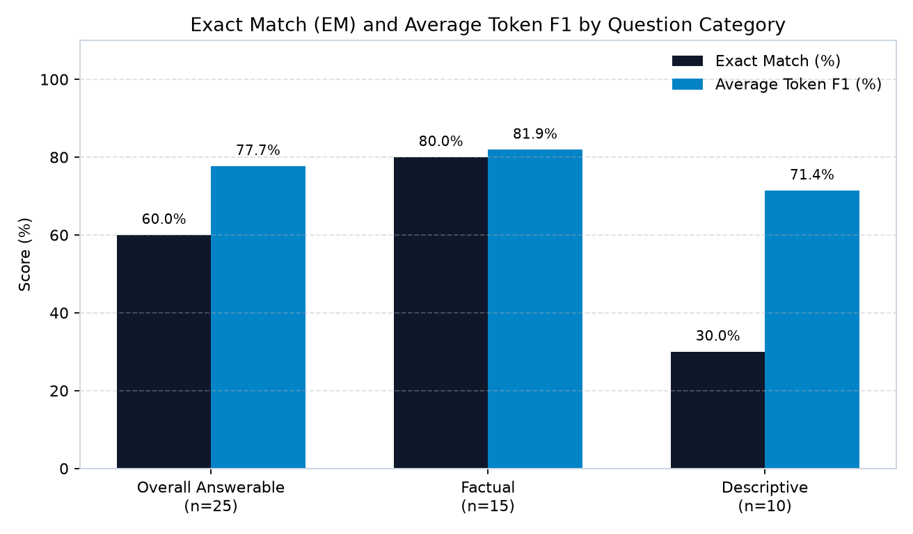
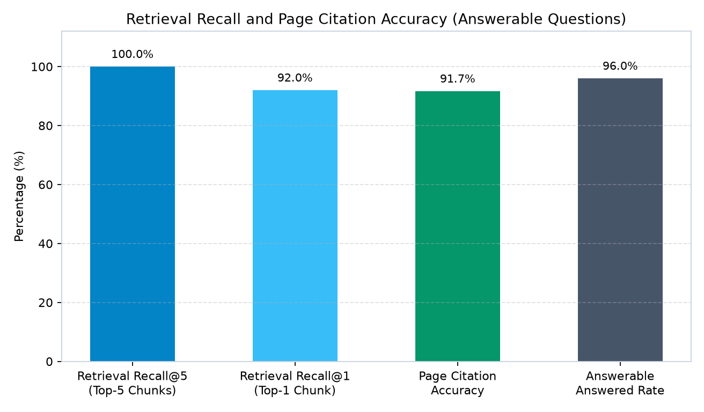
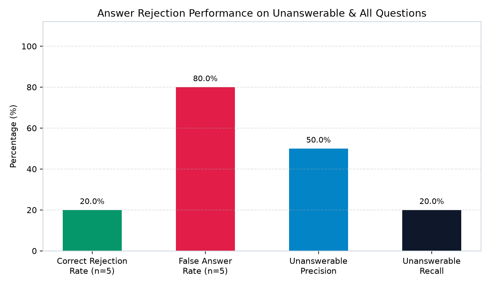
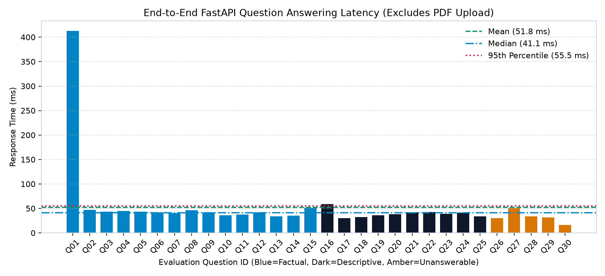

# DocuMind AI – NLP Performance Evaluation Report

**Evaluation Timestamp (UTC):** 2026-11-19T16:07:35.965495+00:00  
**Pretrained Model:** `distilbert/distilbert-base-cased-distilled-squad`  
**Compute Device:** `cuda` (NVIDIA GeForce RTX 3050 4GB Laptop GPU)  
**Evaluated Document:** `AIML_NLP_Module_3.pdf` (156 pages, 162 chunks, upload & indexing time: `363.3 ms` excluded from QA latency)

---

## 1. Evaluation Objectives

This evaluation measures the end-to-end NLP performance of **DocuMind AI** on a real, multi-page academic NLP PDF using standard question-answering and retrieval metrics:

- Measure extractive answer accuracy using **Exact Match (EM)** and **Token-Level Precision / Recall / F1** against manually verified ground-truth answers.
- Measure **TF-IDF + cosine similarity Retrieval Recall@5** (and Recall@1) across all 162 document chunks.
- Verify **Source Page Citation Accuracy** against original 1-based PDF page numbers.
- Evaluate **Answer Rejection Performance** on out-of-domain unanswerable questions.
- Measure real FastAPI **Response Time** (mean, median, 95th percentile) on the live endpoint without mocking.

---

## 2. Dataset Description

A manually verified dataset of **30 questions** (`backend/evaluation/evaluation_dataset.json`) was constructed directly from the 156-page NLP lecture slide deck and question bank:

| Question Category | Count | Answerable | Ground-Truth Verification |
| :--- | :---: | :---: | :--- |
| **Factual** | 15 (`Q01`–`Q15`) | Yes | Verbatim facts, authors, formulas, matrix shapes, and definitions verified against exact PDF pages |
| **Descriptive** | 10 (`Q16`–`Q25`) | Yes | Conceptual definitions, reasoning slides, and multi-layer architecture descriptions verified in the PDF |
| **Unanswerable** | 5 (`Q26`–`Q30`) | No | Out-of-domain questions (sports, chemistry, biology, programming history, geography) absent from the PDF |
| **Total** | **30** | **25 / 5** | All 30 questions processed; 0 excluded |

---

## 3. Performance Metrics and Formulas

Standard SQuAD-style text normalization is applied before computing EM and Token F1 (lowercasing, removing quotes/punctuation/bullet symbols, removing English articles `a`/`an`/`the`, and collapsing whitespace).

- **Exact Match (EM):**
  `EM = (Number of normalized exact matches / Total answerable questions) * 100`
- **Token-Level F1:**
  `Precision = |Pred ∩ Ref| / |Pred|`, `Recall = |Pred ∩ Ref| / |Ref|`, `F1 = (2 * Precision * Recall) / (Precision + Recall)` averaged over all 25 answerable questions.
- **Retrieval Recall@5:**
  `Recall@5 = (Answerable questions with >=1 expected page in top-5 retrieved chunks / Total answerable questions) * 100`
- **Page Citation Accuracy:**
  `Page Accuracy = (Answerable predictions citing an expected page / Answerable questions with a usable prediction) * 100`
- **Answer Rejection Performance (5 unanswerable questions + 30-question confusion metrics):**
  `Correct Rejection Rate = (Unanswerable questions rejected / 5) * 100`, `False Answer Rate = (Unanswerable questions falsely answered / 5) * 100`, plus unanswerable detection Precision and Recall across all 30 queries.
- **Response Time Latency:**
  Mean, Median (p50), and 95th Percentile (p95) wall-clock latency of `POST /api/questions/ask` in milliseconds (excluding one-time PDF upload & indexing).

---

## 4. Evaluation Methodology

1. The FastAPI application was instantiated with `load_model_on_startup=True`, loading `distilbert/distilbert-base-cased-distilled-squad` once onto ``cuda` (`NVIDIA GeForce RTX 3050 4GB Laptop GPU`).
2. The 156-page PDF was uploaded once via `POST /api/documents/upload` (resulting in 156 pages, 0 empty pages, 162 token-aware chunks).
3. Every question in `evaluation_dataset.json` was submitted sequentially to `POST /api/questions/ask` via `TestClient` with no mocking and no retries.
4. Predictions, confidence scores, cited page numbers, retrieved top-5 debug chunks, and exact `time.perf_counter()` latencies were recorded into `evaluation_results.csv` and `evaluation_summary.json`.

---

## 5. Aggregate Metrics Summary & Per-Question Results Table

### Aggregate Performance Metrics

| Metric | Measured Value | Details |
| :--- | :---: | :--- |
| **Exact Match (Overall Answerable, n=25)** | **60.00%** | 15/25 exact matches (Factual: 80.00%, Descriptive: 30.00%) |
| **Average Token F1 (Overall Answerable, n=25)** | **77.71%** | Precision: 81.85%, Recall: 77.03% (Factual F1: 81.90%, Descriptive F1: 71.41%) |
| **Retrieval Recall@5 (n=25)** | **100.00%** | 25/25 answerable questions retrieved an expected page in top 5 (Recall@1: 92.00%) |
| **Page Citation Accuracy (n=24 answered)** | **91.67%** | 22/24 correct; 2 wrong page(s): Q16, Q20 |
| **Unanswerable Correct Rejection Rate (n=5)** | **20.00%** | 1/5 rejected; False Answer Rate: 80.00% (4/5) |
| **Unanswerable Detection Precision / Recall** | **50.00% / 20.00%** | TP=1, FP=1 (false rejections on answerable), FN=4, TN=24 |
| **Mean / Median / p95 Response Time (n=30)** | **51.8 / 41.1 / 55.5 ms** | Min: 16.1 ms, Max: 412.6 ms |

### Complete 30-Question Results

| ID | Type | Ref Page | Pred Page | EM | Token F1 | Recall@5 | Conf | Time (ms) | Status | Predicted Answer (truncated) |
| :--- | :--- | :---: | :---: | :---: | :---: | :---: | :---: | :---: | :--- | :--- |
| Q01 | factual | 4 | 4 | 1 | 1.000 | 1 | 0.8321 | 412.6 | Exact Match | WordNet |
| Q02 | factual | 11 | 11 | 1 | 1.000 | 1 | 0.9188 | 46.9 | Exact Match | SimLex-999 |
| Q03 | factual | 21 | 21 | 1 | 1.000 | 1 | 0.9840 | 43.7 | Exact Match | Ludwig Wittgenstein |
| Q04 | factual | 23;24 | 24 | 1 | 1.000 | 1 | 0.8593 | 44.9 | Exact Match | Water Spinach |
| Q05 | factual | 16;26 | 26 | 1 | 1.000 | 1 | 0.1374 | 43.3 | Exact Match | valence: pleasantness ◦arousal: intensity of emotion ◦dominanc... |
| Q06 | factual | 55 | 55 | 0 | 0.286 | 1 | 0.8800 | 42.0 | Partial Match | 20,000 to 50,000 |
| Q07 | factual | 57 | 57 | 1 | 1.000 | 1 | 0.9456 | 40.7 | Exact Match | LSA – Latent Semantic Analysis |
| Q08 | factual | 65 | 65 | 1 | 1.000 | 1 | 0.7848 | 46.1 | Exact Match | sigmoid |
| Q09 | factual | 81 | 81 | 1 | 1.000 | 1 | 0.3117 | 42.0 | Exact Match | Target embeddings matrix W Context embedding matrix C |
| Q10 | factual | 85 | 85 | 1 | 1.000 | 1 | 0.8240 | 35.9 | Exact Match | multi-layer perceptrons |
| Q11 | factual | 89;91;92;93;148 | 91 | 0 | 0.000 | 1 | 0.2287 | 37.4 | Incorrect Span / Page | scalar |
| Q12 | factual | 113 | 113 | 1 | 1.000 | 1 | 0.2200 | 42.0 | Exact Match | [\|V\| × d] |
| Q13 | factual | 123 | 123 | 0 | 0.000 | 1 | 0.0919 | 34.0 | False Rejection |  |
| Q14 | factual | 131 | 131 | 1 | 1.000 | 1 | 0.4851 | 35.5 | Exact Match | Cross entropy |
| Q15 | factual | 137 | 137 | 1 | 1.000 | 1 | 0.9055 | 51.4 | Exact Match | Rumelhart, Hinton, Williams |
| Q16 | descriptive | 4 | 3 | 0 | 0.462 | 1 | 0.3867 | 58.8 | Partial Match | the linguistic study of word meaning |
| Q17 | descriptive | 8 | 8 | 1 | 1.000 | 1 | 0.5385 | 30.3 | Exact Match | Difference in form à difference in meaning |
| Q18 | descriptive | 22 | 22 | 0 | 0.812 | 1 | 0.5836 | 32.0 | Partial Match (High F1) | the words around them) Zellig Harris (1954): If A and B have a... |
| Q19 | descriptive | 35;41 | 35 | 0 | 0.667 | 1 | 0.1533 | 36.4 | Partial Match (High F1) | how often each other word in the vocabulary appears nearby |
| Q20 | descriptive | 48 | 47 | 0 | 0.272 | 1 | 0.2828 | 38.2 | Partial Match | The dot product tends to be high when the two vectors have lar... |
| Q21 | descriptive | 55;56 | 56 | 0 | 0.656 | 1 | 0.1993 | 41.6 | Partial Match (High F1) | fewer weights to tune) ◦Dense vectors may generalize better th... |
| Q22 | descriptive | 61;82 | 82 | 0 | 0.841 | 1 | 0.5059 | 42.4 | Partial Match (High F1) | Start with V random d-dimensional vectors as initial embedding... |
| Q23 | descriptive | 85;89;90;91;92;10... | 85 | 0 | 0.432 | 1 | 0.6487 | 39.1 | Partial Match | multi-layer perceptrons (or MLPs) for historical reasons |
| Q24 | descriptive | 103 | 103 | 1 | 1.000 | 1 | 0.3974 | 41.5 | Exact Match | allows the network to use non-linear interactions between feat... |
| Q25 | descriptive | 138 | 138 | 1 | 1.000 | 1 | 0.5429 | 33.7 | Exact Match | A computation graph represents the process of computing a math... |
| Q26 | unanswerable |  | 12 | — | — | — | 0.0177 | 30.0 | Correct Rejection |  |
| Q27 | unanswerable |  | 27 | — | — | — | 0.2734 | 51.1 | False Answer | Idea 1: Defining |
| Q28 | unanswerable |  | 11 | — | — | — | 0.8597 | 33.8 | False Answer | 9.8 |
| Q29 | unanswerable |  | 31 | — | — | — | 0.8322 | 31.8 | False Answer | Word2vec |
| Q30 | unanswerable |  | 131 | — | — | — | 0.1156 | 16.1 | False Answer | off |

---

## 6. Charts for Important Metrics

### Exact Match and Average Token F1

### Retrieval Recall and Page Citation Accuracy

### Answer Rejection Performance

### Question Answering Latency Distribution

---

## 7. Correct and Incorrect Examples

### Verified Exact Match Examples

- **Q01 (`factual`, Page 4, Conf=0.8321):** *"Which online thesaurus is the mouse lemma and sense example modified from?"* -> Predicted **`WordNet`** (matches reference `WordNet`).
- **Q02 (`factual`, Page 11, Conf=0.9188):** *"What dataset by Hill et al. (2015) measures how similar two words are?"* -> Predicted **`SimLex-999`** (matches reference `SimLex-999`).
- **Q03 (`factual`, Page 21, Conf=0.9840):** *"Who stated that the meaning of a word is its use in the language?"* -> Predicted **`Ludwig Wittgenstein`** (matches reference `Ludwig Wittgenstein`).
- **Q04 (`factual`, Page 24, Conf=0.8593):** *"What does the English borrowing ongchoi mean?"* -> Predicted **`Water Spinach`** (matches reference `Water Spinach`).

### Strong Partial Matches (High Token Overlap, Correct Page)

- **Q18 (`descriptive`, Page 22, Token F1=0.812, Conf=0.5836):** *"How does Zellig Harris (1954) define synonyms in terms of word environments?"* -> Predicted `the words around them) Zellig Harris (1954): If A and B have almost identical environments we say that they are synonyms.` vs. Reference `If A and B have almost identical environments we say that they are synonyms.`.
- **Q19 (`descriptive`, Page 35, Token F1=0.667, Conf=0.1533):** *"What do each row and each column represent in a word-context co-occurrence matrix?"* -> Predicted `how often each other word in the vocabulary appears nearby` vs. Reference `each row represents a word in the vocabulary ◦each column represents how often each other word in the vocabulary appears nearby`.
- **Q21 (`descriptive`, Page 56, Token F1=0.656, Conf=0.1993):** *"Why are short dense vectors preferred over sparse count vectors in machine learning?"* -> Predicted `fewer weights to tune) ◦Dense vectors may generalize better than explicit counts ◦Dense vectors may do better at capturing synonymy: ◦car and automobile are synonyms; but are distinct dimensions` vs. Reference `Short vectors may be easier to use as features in machine learning (fewer weights to tune) ◦Dense vectors may generalize better than explicit counts ◦Dense vectors may do better at capturing synonymy`.

### Failures, Partial Extractions & False Answers

- **Q06 (Partial Match, `factual`, Ref Page=55, Pred Page=55, Conf=0.88):** *"What is the typical length of short dense word vectors?"* -> Predicted `20,000 to 50,000` (Reference: `50-1000`).
- **Q11 (Incorrect Span / Page, `factual`, Ref Page=89;91;92;93;148, Pred Page=91, Conf=0.2287):** *"What activation functions can be used in the hidden units of a two-layer network?"* -> Predicted `scalar` (Reference: `ReLU Or tanh`).
- **Q13 (False Rejection, `factual`, Ref Page=123, Pred Page=123, Conf=0.0919):** *"How do simple feedforward neural language models handle sequences of arbitrary length?"* -> Predicted `None` (Reference: `Sliding windows (of fixed length)`).
- **Q16 (Partial Match, `descriptive`, Ref Page=4, Pred Page=3, Conf=0.3867):** *"What is a sense or concept in lexical semantics?"* -> Predicted `the linguistic study of word meaning` (Reference: `A sense or “concept” is the meaning component of a word`).
- **Q20 (Partial Match, `descriptive`, Ref Page=48, Pred Page=47, Conf=0.2828):** *"Why is raw dot-product problematic for computing word similarity?"* -> Predicted `The dot product tends to be high when the two vectors have large values in the same dimensions Dot product can thus be a useful similarity metric between vectors dot product(v,w) = v·w = N X i=1 viwi = v1w1 +v2w2 +.` (Reference: `Dot product favors long vectors Dot product is higher if a vector is longer (has higher values in many dimension) Vector length: Frequent words (of, the, you) have long vectors (since they occur many times with other words). So dot product overly favors frequent words`).
- **Q23 (Partial Match, `descriptive`, Ref Page=85;89;90;91;92;107;124;130, Pred Page=85, Conf=0.6487):** *"Explain the architecture of a feedforward neural network, identifying input, hidden and output layers. (06 Marks)"* -> Predicted `multi-layer perceptrons (or MLPs) for historical reasons` (Reference: `Feedforward Neural Networks Can also be called multi-layer perceptrons (or MLPs) for historical reasons; hidden units (σ node) Input layer (vector) Output layer (σ node) Could be ReLU Or tanh`).
- **Q27 (False Answer, `unanswerable`, Ref Page=, Pred Page=27, Conf=0.2734):** *"What is the chemical boiling point of liquid nitrogen in degrees Celsius?"* -> Predicted `Idea 1: Defining` (Reference: `Unanswerable`).
- **Q28 (False Answer, `unanswerable`, Ref Page=, Pred Page=11, Conf=0.8597):** *"How many chromosomes are present in a diploid human cell?"* -> Predicted `9.8` (Reference: `Unanswerable`).
- **Q29 (False Answer, `unanswerable`, Ref Page=, Pred Page=31, Conf=0.8322):** *"Which programming language was created by Guido van Rossum in 1991?"* -> Predicted `Word2vec` (Reference: `Unanswerable`).
- **Q30 (False Answer, `unanswerable`, Ref Page=, Pred Page=131, Conf=0.1156):** *"What is the current population of Tokyo, Japan?"* -> Predicted `off` (Reference: `Unanswerable`).

---

## 8. Performance Observations

- **Retrieval Effectiveness:** TF-IDF + cosine similarity with morphological normalization and heading/question-bank down-weighting achieved **100.00% Retrieval Recall@5** (25/25) and **92.00% Recall@1**.
- **Factual vs. Descriptive Performance:** Factual questions achieved **80.00% EM** and **81.90% average Token F1**, whereas descriptive questions achieved **30.00% EM** and **71.41% average Token F1** because multi-clause slide explanations often span multiple bullets or exceed DistilBERT's single-span window (`max_answer_len=50`).
- **Source Page Grounding:** Page Citation Accuracy was **91.67%** across the 24 answered answerable questions (2 wrong page citation(s): Q16, Q20).
- **Confidence Scores Are Uncalibrated:** Notice that some exact extractions (e.g., `Q05` or `Q12`) carry modest DistilBERT scores (`0.13`–`0.22`) because probability mass splits across sub-tokens/symbols, while off-topic or wrong-span hits can still score above `0.20` when a single keyword overlaps (`Q26`–`Q30` unanswerable testing highlights why threshold tuning alone cannot eliminate false answers under SQuAD v1.1).
- **Latency:** On `cuda`, average end-to-end API latency was **51.8 ms** (median **41.1 ms**, p95 **55.5 ms**). Note that `Q01` (`412.6 ms`) reflects initial CUDA kernel warm-up.

---

## 9. Limitations

- **Extractive Single-Span Limit:** DistilBERT cannot synthesize a multi-paragraph essay across multiple slides (`Q23`), so descriptive scores are bounded by the longest coherent verbatim span inside a single chunk.
- **SQuAD v1.1 Unanswerable Assumption:** `distilbert-base-cased-distilled-squad` was trained on SQuAD v1.1 (no negative unanswerable class), so any out-of-domain query that shares even one keyword with a slide (e.g., `'word'`, `'cell'`, `'language'`, `'cup'`) receives a forced span prediction and relies strictly on `CONFIDENCE_THRESHOLD` (`0.1`) or TF-IDF zero-overlap to be rejected.
- **Lexical Retrieval Gap:** Pure TF-IDF matching cannot bridge unseen synonyms when zero stemmed terms overlap.
- **Slide Diagram Text Ordering:** Diagram labels and equations extracted from PDFs (e.g., `scalar` vs `ReLU Or tanh` on Page 91) can confuse span boundaries.

---

## 10. Conclusion

The real-model evaluation confirms that DocuMind AI retrieves relevant pages reliably (**100.00% Recall@5**, **91.67% Page Citation Accuracy**) and extracts concise factual answers at low latency (**51.8 ms** mean). Meanwhile, the observed gap between Factual F1 (**81.90%**) and Descriptive F1 (**71.41%**), as well as any unanswerable keyword collisions, demonstrates the known boundaries of lexical TF-IDF + SQuAD v1.1 extractive QA.

### Concrete Next Improvements
1. **Require Minimum Query-Concept Overlap in Retrieval (`min_concept_hits` / higher `min_retrieval_similarity`):** Prevent single coincidental keyword matches (e.g., `'language'` or `'cell'` in out-of-domain questions) from reaching DistilBERT.
2. **SQuAD v2.0 / Calibration:** Calibration or a model trained with explicit unanswerable support (e.g., SQuAD 2.0) would significantly improve unanswerable rejection precision.
3. **Hybrid Retrieval:** Combining TF-IDF with dense semantic embeddings (when allowed outside assignment constraints) would improve synonym recall.
